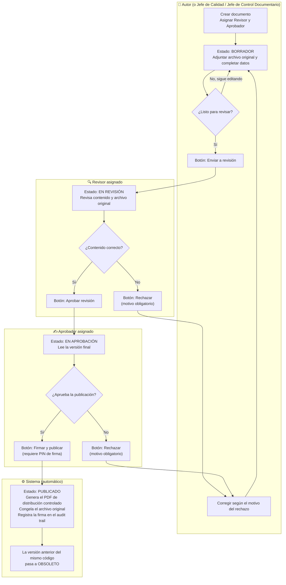
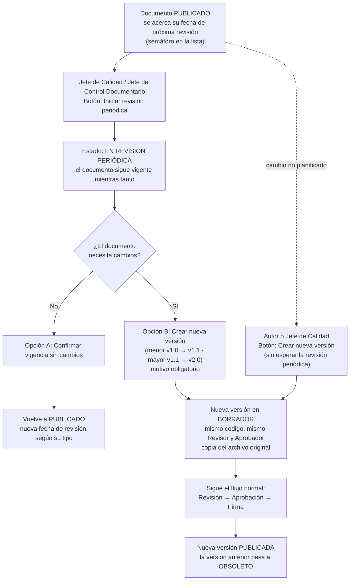
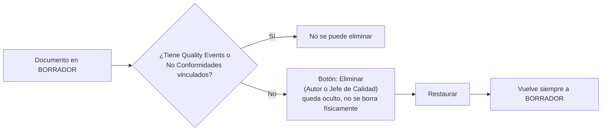

# SHAC — Mapa de proceso: Control Documentario (M1)

Este mapa explica qué pasa con un documento desde que se crea hasta que se publica, quién tiene que actuar en cada paso y qué botón usa. También cubre los caminos alternativos: rechazos, revisión periódica, nuevas versiones y eliminación.

> Construido a partir del comportamiento real del sistema (backend y pantallas), no del diseño original.

---

## 1. Ciclo de vida del documento

```mermaid
stateDiagram-v2
    direction LR

    state "Borrador" as BORRADOR
    state "En Revisión" as EN_REVISION
    state "En Aprobación" as EN_APROBACION
    state "Publicado (vigente)" as PUBLICADO
    state "En Revisión Periódica" as EN_REVISION_PERIODICA
    state "Obsoleto" as OBSOLETO

    [*] --> BORRADOR : Autor crea el documento
    BORRADOR --> EN_REVISION : Autor o Jefe de Calidad - Enviar a revisión
    EN_REVISION --> EN_APROBACION : Revisor - Aprobar revisión
    EN_REVISION --> BORRADOR : Revisor - Rechazar con motivo
    EN_REVISION --> BORRADOR : Jefe de Calidad - Cancelar revisión
    EN_APROBACION --> PUBLICADO : Aprobador - Firmar y publicar con PIN
    EN_APROBACION --> BORRADOR : Aprobador - Rechazar con motivo
    PUBLICADO --> EN_REVISION_PERIODICA : Jefe de Calidad - Iniciar revisión periódica
    EN_REVISION_PERIODICA --> PUBLICADO : Jefe de Calidad - Confirmar vigencia sin cambios
    PUBLICADO --> OBSOLETO : Automático al publicarse una versión nueva
    EN_REVISION_PERIODICA --> OBSOLETO : Automático al publicarse una versión nueva
    OBSOLETO --> [*]
```

**Notas:**

- Los rechazos **siempre** devuelven el documento a Borrador, con el motivo registrado. El autor corrige y vuelve a enviarlo a revisión.
- **Obsoleto** es un estado final. Un documento obsoleto se puede consultar, pero no editar ni distribuir.

---

## 2. Flujo principal con responsables (¿a quién le toca?)

**Reglas que conviene conocer:**

| Regla | Detalle |
|---|---|
| Revisor ≠ Aprobador | Deben ser personas distintas, y el autor no puede ser ninguno de los dos. |
| Quién puede ser Revisor | Jefe de Calidad/SyST, Jefe de Control Documentario, Auditor Interno o Alta Dirección. |
| Quién puede ser Aprobador | Jefe de Control Documentario o Alta Dirección. |
| Firma | Solo el Aprobador asignado puede firmar, y necesita tener configurado su **PIN de firma** en su perfil. |
| Bloqueo por Quality Event | Si la versión anterior está vinculada a un Quality Event que no está Cerrado ni Verificado, no se puede publicar la nueva hasta que ese QE se cierre. |
| Botones visibles | Cada usuario ve **solo** los botones que le corresponden. El revisor no ve "Firmar" y el aprobador no ve "Aprobar revisión". |

---

## 3. Revisión periódica y nuevas versiones

Cada tipo de documento tiene una periodicidad de revisión: Política, Procedimiento y Plan cada 12 meses, Instructivo cada 24 y Material cada 6. Registro e Informe no tienen revisión periódica.

**Importante:** cada código de documento solo puede tener **una** versión en proceso a la vez (en Borrador, En Revisión o En Aprobación). Si ya hay una en curso, el botón para crear otra aparece deshabilitado.

---

## 4. Eliminar y restaurar

---

## 5. ¿Qué sigue con mi documento? (guía rápida)

| Si el documento está en… | Le toca a… | Qué tiene que hacer |
|---|---|---|
| **Borrador** | Autor (o Jefe de Calidad / Jefe de Control Documentario) | Completar los datos, adjuntar el archivo original y pulsar **Enviar a revisión**. Mientras no se envíe, **el revisor no puede actuar**. |
| **En Revisión** | Revisor asignado | Abrir el documento y pulsar **Aprobar revisión** o **Rechazar** (con motivo). |
| **En Aprobación** | Aprobador asignado | Abrir el documento y pulsar **Firmar y publicar** (con PIN) o **Rechazar** (con motivo). |
| **Publicado** | Nadie, ya está vigente | Se consulta y se descarga el PDF controlado. Cuando se acerque la fecha, el Jefe de Calidad inicia la revisión periódica. |
| **En Revisión Periódica** | Jefe de Calidad / Jefe de Control Documentario | Confirmar vigencia sin cambios, o crear una nueva versión. |
| **Obsoleto** | Nadie | Solo consulta histórica. |

### Ejemplo: acabo de crear **PRC-CD-013**

1. **PRC-CD-013 está en Borrador.** Aunque ya tiene Revisor y Aprobador asignados, ellos todavía **no pueden hacer nada**: el documento no les llega hasta que se envía a revisión.
2. El **autor** (o un Jefe de Calidad / Jefe de Control Documentario) abre PRC-CD-013, revisa que esté completo y pulsa **Enviar a revisión**.
3. El **Revisor** entra al documento y lo aprueba o lo rechaza.
4. Si lo aprueba, el **Aprobador** lo firma con su PIN y PRC-CD-013 queda **Publicado** como v1.0. Su próxima revisión se programa a 12 meses, porque es un Procedimiento.
